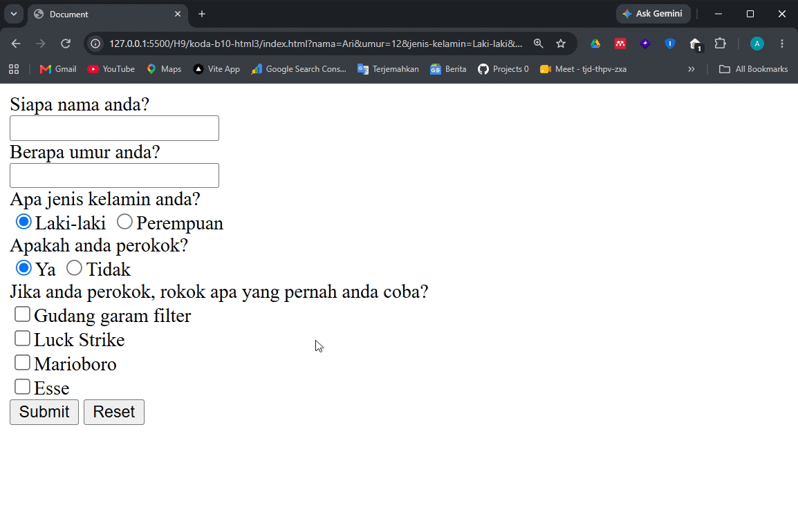
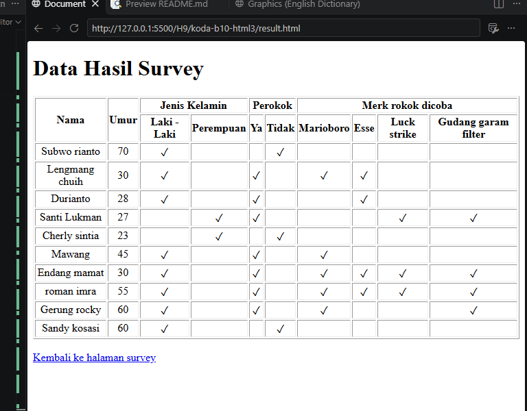
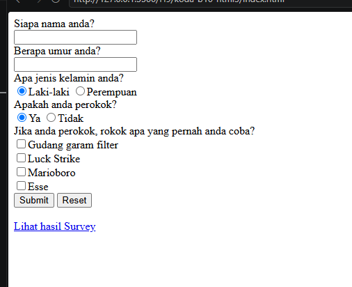

# HTML Form
on this repo i learn to create a HTML form using multiple inputs such as
text, number, options, checkbox, and radio button. and i also add submit button
with reset button in the end of the form, to structuring content inside form
i use div element

## Refactor
i have refactor this code to improve the ui design i use flexbox with custom checkbox and radio button

### Result Refactor
.png>)

## Old result
here the result

## feature
### Result page
i added a result page to mimic the actual data have been send from submit

### and also link to access directly into result page
